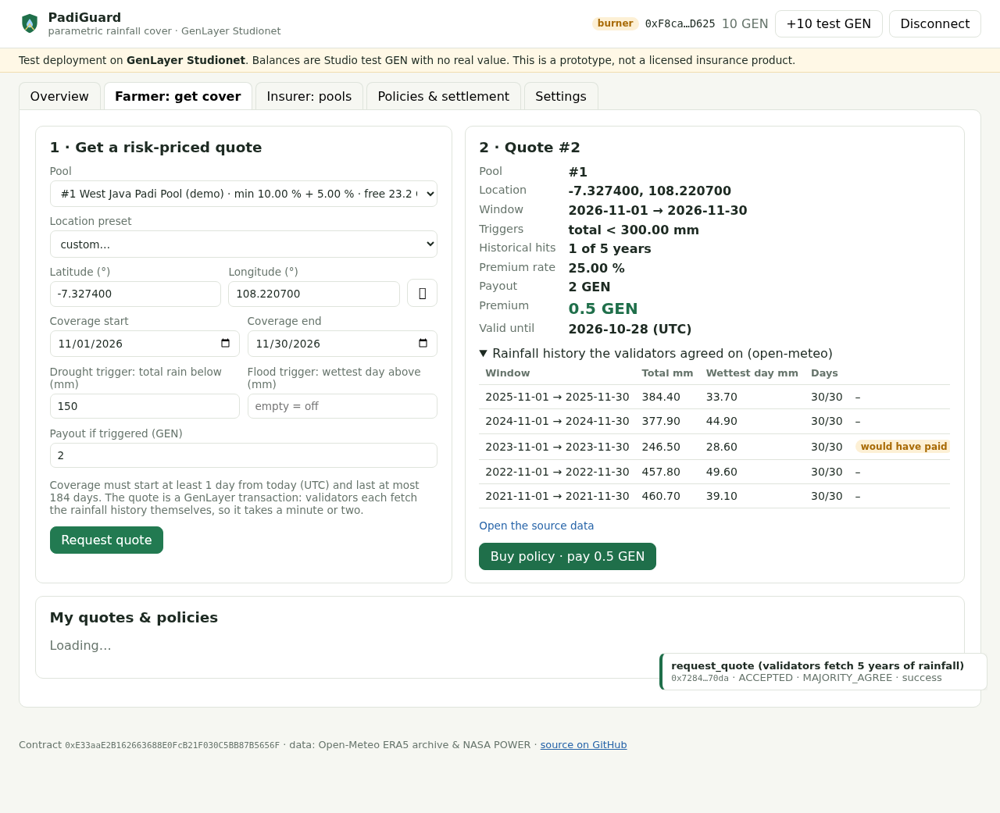

# PadiGuard: multi-insurer parametric rainfall insurance on GenLayer

PadiGuard is a web dApp plus a GenLayer Intelligent Contract for **parametric
rainfall cover for rice farmers** (*padi* is Indonesian for rice). Insurers open
capital pools. A farmer picks a pool, a field location, a coverage window and a
drought and/or flood trigger. **GenLayer validators price the policy from five
years of rainfall history at that location**, the farmer buys it, and after the
season **validators settle it from two public weather sources**. If a trigger
was hit, the payout goes straight to the farmer. There are no claim forms.

> **Status: working prototype on GenLayer Studionet** (test GEN, no real value).
> It is not a licensed insurance product. Contract
> `0xE33aaE2B162663688E0FcB21F030C5BB87B5656F`; see [docs/LIVE_RUN.md](docs/LIVE_RUN.md)
> for every transaction of the live run.



## Use case

Smallholder rice farmers in West Java lose harvests to dry spells (El Niño years)
and to extreme rain days. Indemnity insurance needs loss adjusters, and that is
too expensive for small plots. Parametric cover pays on a measurable index
(rainfall) instead, but it needs two things a normal smart contract cannot do on
its own:

1. **Price** a policy for an arbitrary field from historical weather data.
2. **Settle** it from weather data for that exact field and window, without a
   trusted oracle operator.

PadiGuard does both inside GenLayer consensus.

## How GenLayer is central

The app has no backend. The browser talks only to the GenLayer contract, through
`genlayer-js`. The two steps that make the product work are non-deterministic
GenLayer transactions:

| Step | Contract method | What validators do |
|---|---|---|
| **Quote** (new in PadiGuard) | `request_quote` | Each validator fetches daily precipitation for the same calendar window in each of the last 5 years from the Open-Meteo ERA5 archive. They must agree on every year's totals (within tolerance) and on exactly which years would have triggered a payout. The contract prices the premium from that hit count. |
| **Settle** | `settle` | Each validator fetches the coverage window from Open-Meteo ERA5 **and** NASA POWER, and they must agree on per-source coverage, totals, the trigger outcome and the exact payout. Then the contract pays, closes, or defers. |

Without GenLayer there would be no price and no payout. Both would need a trusted
off-chain service. The equivalence checks are documented in
[CONSENSUS.md](CONSENSUS.md).

## What is new compared with my earlier contract

This project builds on my earlier, single-insurer Intelligent Contract
[genlayer-rainfall-insurance](https://github.com/syariffadilla/genlayer-rainfall-insurance)
(Studionet `0x6c84A4F9B0F00c12214FBECec8cBe421Bd0CE3a3`). The settlement
consensus helpers (`_fetch_evidence`, `_decide`, `_evidence_matches`) are reused
**unchanged**. New in PadiGuard:

* **A multi-insurer pool marketplace.** Any account can open a pool with its own
  capital, reserve, minimum rate, loading and coverage region (lat/lon box). The
  earlier contract had one insurer, the deployer, and one flat rate.
* **Risk-priced quotes from rainfall history.** A new non-deterministic method,
  `request_quote`, has its own validator equivalence check. The quote, with the
  agreed per-year history, is stored on-chain and `buy_policy(quote_id)` charges
  exactly that premium.
* **Per-pool accounting.** Payouts, refunds and withdrawals come from the policy's
  own pool, and pools are isolated from each other (tested).
* **Read views for a UI:** stats, paginated pool and policy lists, per-farmer
  policies and quotes, per-insurer pools, per-pool policies, and the source URLs
  for quotes and settlement.
* **The web dApp** (`frontend/`): wallet or burner account, Studio faucet,
  insurer and farmer flows, policy pages with settlement evidence, and a
  transaction log.

## Architecture

```
 Browser (static Vite app, frontend/)                 GenLayer Studionet
 ┌───────────────────────────────────┐   genlayer-js   ┌──────────────────────────────────────┐
 │ Overview  · get_stats, list_pools │ ──────────────► │ PadiGuard (contracts/padi_guard.py)   │
 │ Farmer    · request_quote ────────┼─ write ───────► │  pools ─ quotes ─ policies (TreeMaps) │
 │           · buy_policy (+premium) │                 │                                      │
 │ Insurer   · create/fund/withdraw  │                 │  request_quote ── run_nondet ──┐      │
 │ Policies  · settle / expire /     │                 │  settle ───────── run_nondet ──┤      │
 │             cancel, evidence      │ ◄── views ───── │                                │      │
 └───────────────────────────────────┘                 └────────────────────────────────┼──────┘
   account: burner key (localStorage)                    leader + validators each fetch: │
   or MetaMask (window.ethereum)                         Open-Meteo ERA5 archive ◄───────┤
                                                         NASA POWER daily API  ◄─────────┘ (settle only)
```

Policy lifecycle:

```
 request_quote ─► Quote (valid 3 days) ─► buy_policy ─► ACTIVE ─┬─ cancel (before start) ─► CANCELLED (premium refunded)
                                                                ├─ settle → PAYOUT ───────► PAID_OUT (payout to farmer)
                                                                ├─ settle → NO_PAYOUT ────► SETTLED_NO_PAYOUT
                                                                ├─ settle → DEFER ────────► stays ACTIVE, retry later
                                                                └─ expire (after deadline) ► EXPIRED_REFUNDED
 settle window: end_date + 7 days … end_date + 67 days
```

Pricing: `rate = min(100 %, max(pool.min_rate, hits/5 + pool.loading))`, and
`premium = ceil(payout × rate)`. All money and rainfall values are integers: wei,
micro-degrees, and hundredths of a mm.

## Contract API (`contracts/padi_guard.py`)

| Method | Type | Who | Notes |
|---|---|---|---|
| `create_pool(name, min_rate_bps, loading_bps, lat_min, lat_max, lon_min, lon_max)` | write, payable | anyone | `msg.value` = optional first deposit. Returns the pool id. |
| `fund_pool(pool_id)` | write, payable | pool insurer | |
| `withdraw(pool_id, amount)` | write | pool insurer | Unreserved funds only. |
| `set_pool_pricing(pool_id, min_rate_bps, loading_bps)` | write | pool insurer | Applies to new quotes. |
| `set_pool_accepting(pool_id, bool)` | write | pool insurer | Opens or closes the pool to new quotes and purchases. |
| `request_quote(pool_id, lat, lon, start, end, drought_mm100, flood_mm100, payout)` | write, **non-deterministic** | farmer | Validates the terms, agrees on 5 years of history, stores the quote. |
| `buy_policy(quote_id)` | write, payable | quote requester | `msg.value` must equal the quoted premium. Re-checks dates, pool status and liquidity. |
| `cancel_policy(policy_id)` | write | farmer | Before coverage starts: full refund. |
| `settle(policy_id)` | write, **non-deterministic** | anyone | Two-source settlement; pays, closes or defers. |
| `expire(policy_id)` | write | anyone | After the claim deadline, if still ACTIVE: refunds the premium. |
| `get_stats()`, `get_pool(id)`, `list_pools(offset, limit)` | view | | |
| `get_quote(id)`, `get_farmer_quotes(addr)`, `get_quote_source_url(id)` | view | | |
| `get_policy(id)`, `list_policies(offset, limit)`, `get_farmer_policies(addr)`, `get_pool_policies(pool_id)`, `get_insurer_pools(addr)`, `get_source_urls(policy_id)` | view | | |

Rules carried over from the earlier contract: coverage starts 1–365 days after
purchase and lasts at most 184 days. At least one trigger is required (0 means
disabled). The pool must have free liquidity of at least the payout.

## Deployed contract

| | |
|---|---|
| Network | GenLayer Studionet (`https://studio.genlayer.com/api`) |
| Address | `0xE33aaE2B162663688E0FcB21F030C5BB87B5656F` |
| Deploy tx | `0x693b613c27ba019dcb8bc1f0f5cad860c9adc2720b9c9b815a8a8c9e72486641` (FINALIZED, 5/5 agree) |
| Source sha256 | `45208d51bb412f49458dcbf13fe286102f07115f88a6849196bf91f9901b8803` (`npm run verify-code` compares it with the on-chain code: MATCH) |
| SDK | `py-genlayer:1jb45aa8…` (GenVM v0.2.x) |

**Live run (2026-10-25):** two pools from two different insurer accounts, two
live `request_quote` consensus rounds (FINALIZED, MAJORITY_AGREE), two policies
bought (one from the Node script, one through the web UI in headless Chromium), a
pool withdrawal whose native GEN transfer arrived after finalization, and
`settle()` correctly refused before the settlement window. Full table with hashes:
[docs/LIVE_RUN.md](docs/LIVE_RUN.md).

The demo policies cover 2026-11-01..30, so the first live `settle()` on this
deployment can run from **2026-12-07**.

## Run it

### Contract tests (direct mode, no Studio needed)

```bash
python3 -m pip install -r requirements.txt
genvm-lint check contracts/padi_guard.py       # lint + SDK validation
genvm-lint typecheck contracts/padi_guard.py   # pyright with the GenLayer SDK
pytest tests/direct -q
```

The first run downloads the GenVM v0.2.16 SDK into `~/.cache/gltest-direct`
(`tests/direct/conftest.py` pins it). Weather responses are real API captures; see
[tests/direct/fixtures/README.md](tests/direct/fixtures/README.md).

Result on 2026-10-25: **141 passed**. `genvm-lint check`: lint passed (3
checks), validation passed (22 methods: 12 view, 10 write). `genvm-lint typecheck`:
no type errors.

| File | Tests | Covers |
|---|---|---|
| `test_pools.py` | 12 | create/fund/withdraw/pricing/open-close, region box, isolation between pools, paging, unknown ids |
| `test_quotes.py` | 15 | history-window helper (lag, leap day), rate formula, real-data quotes (drought, flood, both), pool minimum, pricing lock-in, missing day / HTTP 503 / garbage / truncated history refused, input validation |
| `test_quote_validator.py` | 29 | quote equivalence check: agree, tolerance, out-of-tolerance, flipped year, validator can't reach source, missing day, leader error, 18 tampered fields, dropped year, self-consistent lie, small drift, agreement on "incomplete" |
| `test_buy.py` | 8 | buy from quote, exact premium, requester-only, single use, expiry, re-checks at purchase, farmer/pool lookups |
| `test_settle.py` | 19 | payout (drought, flood), no-payout, mean rule, diverge → defer, NASA `-999`, HTTP error then retry, timing, double settle (ported from the earlier contract) |
| `test_validator.py` | 36 | settlement equivalence check (ported) |
| `test_refund_expire.py` | 8 | cancel, expire, full multi-policy lifecycle (ported) |
| `test_rules.py` | 14 | pure decision helpers (ported) |

### Frontend

```bash
cd frontend
npm ci
npm run dev        # http://localhost:5173
npm run build      # static files in frontend/dist (relative base, works on GitHub Pages or Vercel)
```

The default contract address is in `frontend/src/config.js`. You can override it
at build time with `VITE_PADIGUARD_ADDRESS=0x… npm run build`, or in the app under
**Settings**.

Hosting:

* **GitHub Pages:** `.github/workflows/pages.yml` builds `frontend/` and publishes
  it. Turn it on under *Settings → Pages → Source: GitHub Actions*.
* **Vercel:** root directory `frontend`, build command `npm run build`, output
  directory `dist`.

When tested on 2026-10-25, the Studio RPC answered CORS preflight requests from
`localhost`, `127.0.0.1`, a `github.io` origin and a `vercel.app` origin.

### Live demo walkthrough

1. Open the app (local `npm run dev` or the hosted build).
2. Click **Use burner account**, then **+10 test GEN** (Studio faucet). A burner
   key is created in your browser's localStorage. Use it for Studionet test GEN
   only. **Connect MetaMask** also works through `genlayer-js`; it adds or switches
   to the Studionet network.
3. **Insurer: pools** (optional): open a pool with a name, a minimum rate, a
   loading, a region and a deposit.
4. **Farmer: get cover**: pick a pool and a location (presets for West Java rice
   districts or your own coordinates), a window starting tomorrow or later, a
   drought and/or flood trigger and a payout. Then click **Request quote**. After
   validator consensus (about 1–2 minutes on Studionet) the quote shows the 5-year
   history and which years would have paid.
5. **Buy policy**: this pays the exact quoted premium.
6. **Policies & settlement**: open the policy. Once the settlement window is
   open, **Settle now** runs the two-source consensus and shows the recorded
   evidence. Before then the contract rejects it, and you can see that with
   **Try settle anyway**.

### Scripts (Node, same client library as the UI)

```bash
cd frontend
npm run deploy:contract -- --fund-gen 100   # deploy contracts/padi_guard.py (throwaway key, Studio faucet)
node scripts/e2e.mjs pool|faucet|quote|wait <tx>|buy|settle-early|read   # live end-to-end steps
npm run read                                # print live contract state (no key)
npm run verify-code                         # on-chain code == contracts/padi_guard.py ?
```

Keys are read from `PADIGUARD_<ROLE>_KEY`, or from
`../.studionet-padiguard-<role>.key` **outside** the repository, which is created
on first use. `.gitignore` excludes `*.key` and `.env*`. No key is committed.

`tools/browser_check.py` drives the built frontend in headless Chromium
(Playwright) against the live contract. It was used for section B of the live run.

## Limitations

* **Prototype on Studionet.** Test GEN only. This is not an insurance product and
  has no regulatory status.
* **Basis risk.** Gridded reanalysis (about 9 km for ERA5, about 50 km for
  MERRA-2/NASA POWER) is not a rain gauge on the farm. Parametric cover pays on
  the index, not on the actual loss.
* **Simple pricing.** Five years of history and a hit count give a coarse loss
  estimate. A year that only just missed the trigger counts as a miss. Quotes use
  Open-Meteo only, while settlement uses two sources.
* **Binary payout.** One fixed payout per policy, with no graduated tiers.
* **Pools are single-insurer.** One account funds and manages each pool. Pooled LP
  capital is on the roadmap.
* **Quotes cost a consensus round.** Every quote is a non-deterministic
  transaction (about 1–2 minutes on Studionet).
* **Tolerance edge.** A data revision that flips a year or a trigger between the
  leader's and a validator's fetch makes the round rotate (intended).
* **MetaMask path not tested end to end here.** It is implemented with
  `genlayer-js` (`provider: window.ethereum`, `client.connect("studionet")`). The
  burner path is the tested one.
* **SDK version.** Pinned to `py-genlayer:1jb45aa8…` (GenVM v0.2.x). Moving to
  v0.3 needs the documented renames (`run_nondet` → `run_nondet_default`, …).

## Roadmap / future milestones

Planned follow-ups, each meant to be a separately verifiable milestone:

1. **Testnet deployment and first live settlement.** Migrate to the GenVM v0.3
   SDK, deploy to the GenLayer public testnet (Bradbury), host the frontend, and
   record the first live `settle()` rounds (payout or no-payout) with their
   on-chain evidence. The current Studionet demo policies become settleable on
   2026-12-07.
2. **Liquidity-provider capital in pools.** Share-based deposits so several
   accounts can back one pool, with pro-rata premiums and losses and withdrawals
   limited to unreserved capital. UI for LPs (position, share price, utilisation).
3. **Better index and pricing.** A third keyless rainfall source (candidate:
   CHIRPS through a public API, still to be evaluated) to enable a true median at
   settlement, graduated (tiered) payouts, and quotes that use both sources and a
   longer history.
4. **Farmer UX for the field.** Indonesian-language UI, a map picker for the
   field location, mobile layout, and a printable policy certificate.
5. **Distribution partners.** Let cooperatives or MFIs buy and manage policies on
   behalf of member farmers (bulk quotes and purchases, member lookup).

## Repository layout

```
contracts/padi_guard.py           the Intelligent Contract
tests/direct/                     direct-mode tests + real API fixtures (141 tests)
CONSENSUS.md                      quote + settlement equivalence checks
frontend/                         Vite web app (vanilla JS + genlayer-js)
  src/lib/padiguard.js            client library shared by UI and scripts
  src/main.js                     UI
  scripts/                        deploy, e2e, read, verify-code (Node)
docs/LIVE_RUN.md                  live Studionet run with tx hashes
docs/screenshots/                 screenshots from the headless-browser run
tools/browser_check.py            headless Chromium check of the built app
.github/workflows/                CI (lint + tests + build) and GitHub Pages deploy
```

License: MIT
